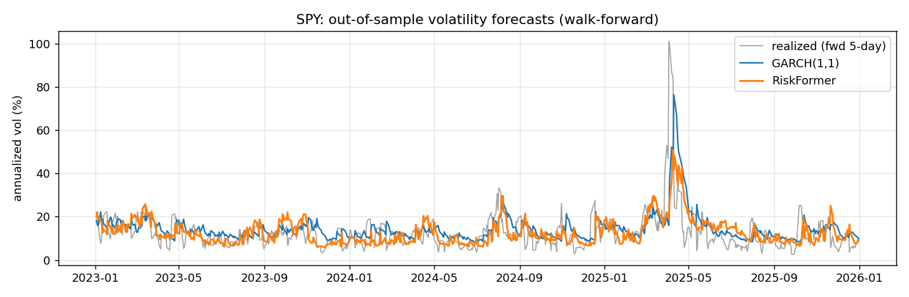
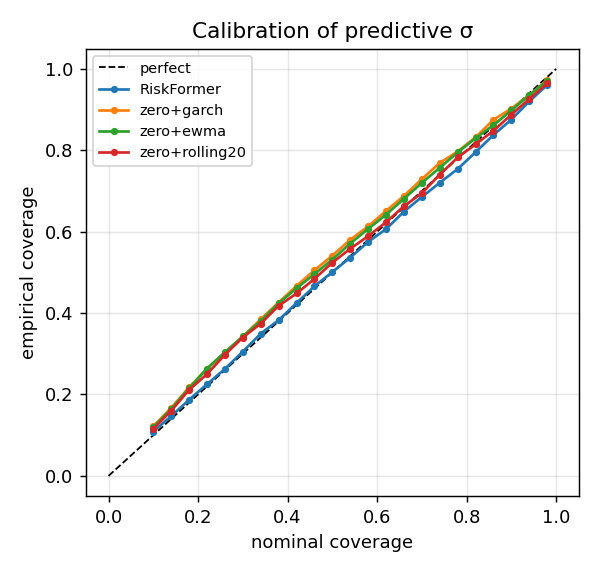
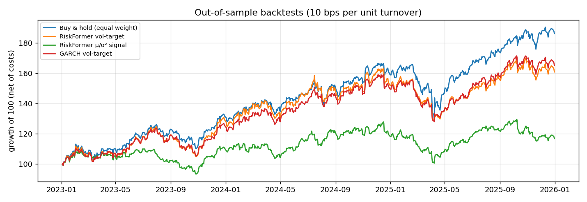

# RiskFormer: Probabilistic Market Forecasting with a Causal Transformer


RiskFormer is a Transformer built from scratch in PyTorch. Given the last 60 trading days of three US equity ETFs (SPY, QQQ, IWM), it forecasts the **distribution** of the next day's return: its mean, its volatility, and its 5% / 50% / 95% quantiles. Every component is written by hand, from causal self-attention to the GARCH baseline, and evaluated walk-forward with no look-ahead.

**Headline result (out of sample, Jan 2023 – Dec 2025):** RiskFormer's volatility forecasts beat GARCH(1,1), EWMA (RiskMetrics) and HAR on QLIKE, Gaussian NLL and forecast–realized correlation. They also stay well calibrated: 91% of returns fell inside its 90% interval. Like every baseline, it has essentially **no edge on the direction of daily returns**, which is the expected and honest outcome for liquid index ETFs.



---

## Results

All numbers are out of sample over **752 trading days × 3 assets**. The walk-forward protocol has 12 quarterly blocks. Before each block, every model is refit on all data up to that quarter, with a 4-day embargo, and then forecasts that quarter. The full tables are in [`results/summary.md`](results/summary.md) and the raw numbers in [`results/metrics.json`](results/metrics.json).

### Volatility and risk (the part that works)

| Model | QLIKE ↓ | Vol RMSE ↓ | Vol corr ↑ | NLL ↓ | z-std (→ 1) | 90% interval coverage | VaR 95% breaches (→ 5%) |
|---|---|---|---|---|---|---|---|
| **RiskFormer (trained once, 2015–21)** | **0.436** | 0.562 | **0.497** | **1.491** | 1.03 | 91.0% | 3.5% |
| RiskFormer (walk-forward fine-tuned) | 0.501 | **0.551** | 0.495 | 1.514 | 1.14 | 89.3% | 4.4% |
| GARCH(1,1) | 0.446 | 0.594 | 0.438 | 1.516 | 1.02 | 90.2% | 5.2% |
| EWMA, λ = 0.94 | 0.487 | 0.619 | 0.372 | 1.532 | 1.05 | 89.8% | 5.5% |
| HAR (Corsi 2009) | 0.596 | 0.579 | 0.412 | 1.572 | 1.24 | 84.3% | 7.7% |
| 20-day rolling std | 0.542 | 0.646 | 0.350 | 1.554 | 1.10 | 88.8% | 5.5% |

How to read this table:
- **QLIKE** is the standard loss for ranking volatility forecasts (Patton 2011).
- **z-std** is the standard deviation of the standardized forecast errors. A value of 1.0 means the predicted uncertainty is the right size.
- One finding worth stating plainly: **fine-tuning every quarter without a validation set made the model slightly worse.** The once-trained model had early stopping; the quarterly refits ran a fixed 10 epochs and overfit recent data. Both are reported, and the choice was not tuned on the test period.



### Returns (the part that doesn't, and shouldn't)

| Model | MAE ↓ | RMSE ↓ | Directional acc. | Rank IC |
|---|---|---|---|---|
| RiskFormer (trained once) | 0.848 | 1.190 | 55.7% | 0.073 |
| Gradient boosting | 0.847 | 1.177 | 54.0% | 0.041 |
| Historical mean ("always up") | 0.851 | 1.195 | 55.7% | 0.017 |
| Zero (random walk) | 0.856 | 1.197 | — | — |
| Yesterday's return | 1.232 | 1.717 | 50.1% | −0.018 |

RiskFormer's 55.7% directional accuracy is the same as always predicting "up" in a market that rose on about 56% of days. The model's main value is in the risk forecasts.

### Backtests (net of 10 bps per unit of turnover, 10% volatility target)

| Strategy | Sharpe | CAGR | Max drawdown |
|---|---|---|---|
| Buy and hold, equal weight | **1.27** | 23.2% | −21.8% |
| Vol-target with EWMA σ | 1.14 | 19.3% | −20.0% |
| Vol-target with GARCH σ | 1.11 | 18.3% | −19.6% |
| Vol-target with RiskFormer σ | 1.00 | 16.0% | −19.1% |
| RiskFormer μ/σ² signal | 0.51 | 6.9% | −18.9% |



**Nothing beats buy and hold in 2023–2025**, a strong bull market with one sharp shock (April 2025). Better volatility forecasts did not turn into better risk-adjusted returns here. The vol-target strategies de-risk after the shock and so miss part of the rebound. Return-signal strategies pay turnover for a signal that is mostly noise. Getting from forecast quality to portfolio quality is a separate problem, and the backtester exists to measure that gap rather than hide it.

---

## How it works

```
Daily OHLCV (yfinance) → clean → 11 stationary features per asset
        │                   (returns, 5/20-day vol, momentum, price/MA, high–low range, volume change)
        ▼
z-score fitted on 2015–2021 only ──► rolling windows  X: (60 days, 3 assets, 11 features)
        ▼
Embeddings: feature projection + sinusoidal time encoding + learned asset embedding
        ▼
Causal Transformer (2 blocks, d=64, 4 heads, pre-LayerNorm) — each asset as its own sequence
        ▼
last time step ──► four heads
   μ        next-day return              ┐
   σ        next-day volatility (>0)     ├─ Gaussian NLL ties μ and σ together
   q        5/50/95% quantiles           │  + log-MSE of σ vs realized 5-day vol
   P(up)    direction                    ┘  + pinball loss + BCE  (weighted multi-task loss)
```

| Phase | Component | Where |
|---|---|---|
| 1 | Market data ingestion and caching | `data/ingestion.py` |
| 2 | Cleaning and feature engineering | `data/cleaning.py`, `data/features.py` |
| 3 | Leakage-safe normalization | `data/normalization.py` |
| 4 | Rolling-window datasets, targets, embargoed splits | `data/dataset.py`, `data/pipeline.py` |
| 5 | Temporal, asset and feature embeddings | `models/embeddings.py` |
| 6 | Causal self-attention, from scratch | `models/attention.py` |
| 7 | Transformer backbone | `models/backbone.py` |
| 8 | Prediction heads and the full model | `models/heads.py`, `models/riskformer.py` |
| 9 | Gaussian NLL, pinball and multi-task losses | `losses/` |
| 10 | Trainer: AdamW, warmup + cosine, clipping, early stopping | `training/` |
| 11 | Walk-forward validation with embargo | `evaluation/walk_forward.py` |
| 12 | Baselines: zero, persistence, mean, MA, Ridge, GBM, EWMA, GARCH, HAR | `baselines/models.py` |
| 13 | Forecast, volatility and calibration metrics | `evaluation/metrics.py` |
| 14 | Backtesting, transaction costs, risk attribution | `backtesting/engine.py` |

### Leakage prevention

Financial ML is easy to fool yourself with, so these rules are enforced in code and checked by tests:
- **Chronological splits:** train 2015–2021, validation 2022 (used only for early stopping), test 2023–2025.
- **Normalization statistics come from the training period only** and are then applied forward.
- **A sample whose target is day *r* sees features up to day *r − 1* only.** A test asserts this.
- **The forward-volatility target looks 5 days ahead,** so the last 4 days of each training period are purged (an embargo) before the next period starts.
- **Causal masking:** a test changes inputs after time *t* and confirms that the representation at *t* doesn't move.
- **Walk-forward refits use only data before each test block.** The GARCH, HAR, Ridge and GBM baselines are refit under the same protocol.
- **Backtest timing:** the position for day *r* is set at the close of *r − 1*, and costs are charged on turnover after the weights drift.

---

## Run it

```bash
git clone https://github.com/Rhea-Thomas/RiskFormer.git
cd RiskFormer
python -m venv .venv && source .venv/bin/activate
pip install -r requirements.txt

python train.py        # downloads data, trains (~35 s on a laptop CPU), saves checkpoints/riskformer.pt
python evaluate.py     # walk-forward + baselines + backtests (~4 min); writes results/
pytest -q              # 98 tests
```

Everything is configured in [`configs/base.yaml`](configs/base.yaml): assets, dates, features, architecture, loss weights, walk-forward steps and backtest costs. Runs are seeded (`system.seed`).

Training curves: [`results/figures/training_curves.png`](results/figures/training_curves.png). Each phase also has a walkthrough script, `phase1_demo.py` … `phase8_demo.py`.

---

## Roadmap

- [x] **Phase 0:** Repository architecture, config, test infrastructure
- [x] **Phase 1:** Market data ingestion (yfinance, caching, validation)
- [x] **Phase 2:** Data cleaning and feature engineering
- [x] **Phase 3:** Leakage-safe normalization
- [x] **Phase 4:** Rolling-window dataset construction
- [x] **Phase 5:** Temporal, asset and feature embeddings
- [x] **Phase 6:** Causal self-attention
- [x] **Phase 7:** Transformer backbone
- [x] **Phase 8:** Prediction heads (return, volatility, quantile, direction)
- [x] **Phase 9:** Probabilistic and multi-task losses
- [x] **Phase 10:** Training pipeline
- [x] **Phase 11:** Walk-forward validation
- [x] **Phase 12:** Baseline models
- [x] **Phase 13:** Evaluation and calibration
- [x] **Phase 14:** Backtesting and risk analysis
- [ ] **Phase 15:** Advanced architecture: cross-asset attention, regime conditioning, attention visualization
- [ ] **Phase 16:** Ablations, hyperparameter search, early-stopped walk-forward refits

## Design decisions

- **Why a small model:** 1,744 training windows of daily data can't support the original 256-d, 4-layer design. The final model has 102k parameters, d = 64, 2 layers and dropout 0.2.
- **Why stationary features:** raw prices and moving averages drift outside their training range, so a 2024 price z-scored with 2015–2021 statistics becomes an extreme outlier. Every feature is a return, a ratio or a range.
- **Why the volatility head doubles as the return σ:** the Gaussian NLL on returns and the log-MSE against realized volatility both train the same σ. One quantity is learned from two signals.
- **Why each asset is its own sequence:** folding assets into the batch keeps the causal mask purely temporal. Cross-asset attention is the next step (Phase 15).
- **Why monotone quantiles:** the quantile head outputs a base value plus positive gaps (softplus), so the 5% quantile can never cross above the 50%.

## Limitations

- There are three highly correlated US equity ETFs and one 3-year test period. The volatility advantage over GARCH is consistent in direction but small in size.
- No volatility-forecast significance test (such as Diebold–Mariano) has been run yet.
- Walk-forward fine-tuning has no early stopping, which is why it underperforms the once-trained model.
- Costs are a flat 10 bps of turnover, with no slippage or market-impact model.

## Disclaimer

This is a machine-learning research and learning project. It does **not** claim to have a profitable trading strategy, and nothing here is financial advice.

## License

MIT
